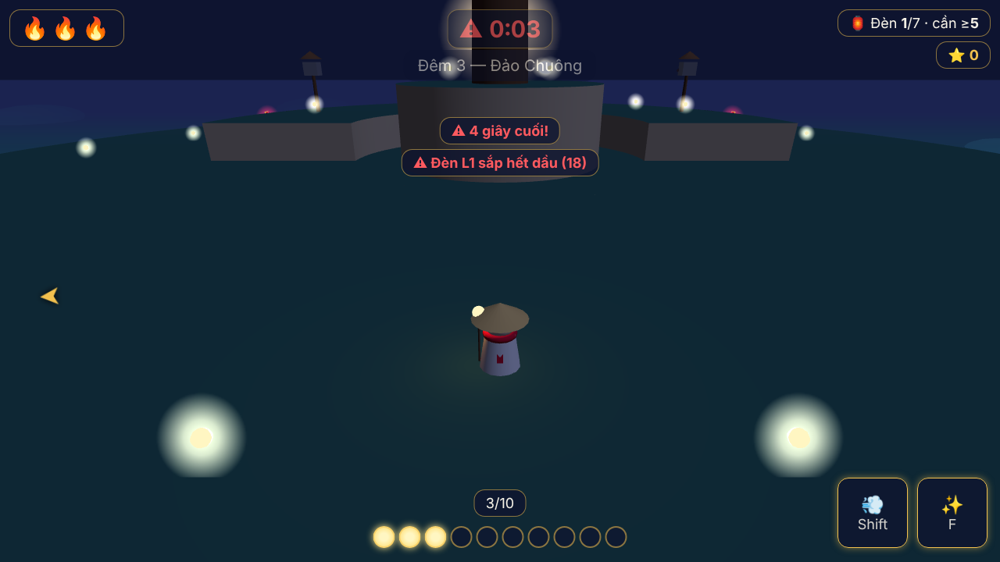
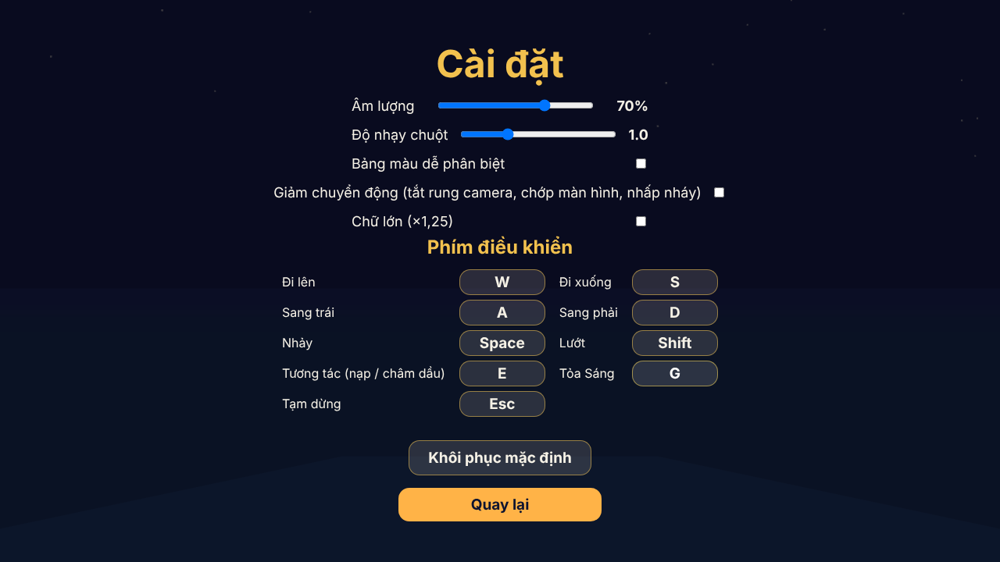

# Đảo Đèn Lồng

> **Video demo:** _(điền link sau khi quay: `docs/demo/demo.mp4` hoặc đính kèm GitHub Release v1.0.0)_
> Bài Day 12 – AI SDLC · Nguyễn Anh Tú · MSSV 2A202603434 · Lớp L3A · **v1.0.0 / Test Contract v1.3**

Game 3D góc nhìn thứ ba. Mây, người giữ đèn nhỏ tuổi, nhặt đom đóm để thắp Đèn Lồng Lớn trên ba hòn đảo giữa biển mây, **giữ cho đủ đèn cháy tới bình minh** và né Bóng Mực — thứ hút dầu đèn trong sương đen.



## Yêu cầu hệ thống

- **Node.js 22+** (đã thử Node 22.15 trên macOS) và **trình duyệt có WebGL2** (Chrome, Edge, Safari, Firefox mới).
- Bản benchmark cần **Chrome / Chromium / Edge** cài sẵn trên máy (tự dò đường dẫn; hoặc đặt `CHROME_BIN`).
- Không cần GPU rời; máy có đồ họa tích hợp chơi được. Âm thanh dùng WebAudio, không cần tệp ngoài.

## Cài đặt và chạy (3 lệnh)

```bash
git clone https://github.com/AnhTu-01/K5-L3A-DAY12-NguyenAnhTu-2A202603434-AI-SDLC-Dao-Den-Long.git && cd K5-L3A-DAY12-NguyenAnhTu-2A202603434-AI-SDLC-Dao-Den-Long
npm install
npm start          # mở http://localhost:8080 (tự mở trình duyệt; NO_OPEN=1 để tắt, PORT=3000 để đổi cổng)
```

**Không muốn cài?** Tải `dao-den-long-v1.0.0.zip` ở trang Release, giải nén rồi `node server.js` (three.js đã kèm sẵn, không cần `npm install`).

## Điều khiển (đổi được trong Cài đặt)

| Phím mặc định | Việc |
|---|---|
| `W A S D` | Di chuyển (theo hướng camera) |
| `←` `→` hoặc kéo chuột | Xoay camera |
| `Space` | Nhảy |
| `Shift` | Lướt (hồi 1,5 s) |
| `E` | Nạp đom đóm vào đèn gần nhất trong 2 m: thắp, thắp lại hoặc **châm dầu** |
| `F` | Tỏa Sáng: tốn 3 đom đóm, choáng và đẩy Bóng Mực trong 5 m |
| `Esc` | Tạm dừng |
| `R` | Chơi lại Đêm (cố định) |

Cài đặt (menu hoặc màn tạm dừng): âm lượng, độ nhạy chuột, **đổi mọi phím** (báo và từ chối khi trùng; nút "Khôi phục mặc định"; lưu lại), bảng màu dễ phân biệt, **giảm chuyển động** (tắt rung camera, chớp màn hình, nhấp nháy), **chữ lớn ×1,25**. Chữ giao diện tối thiểu 18 px ở 1280×720.

## Luật chơi

- 3 Đêm: Đảo Bến (5 đèn, 4:00), Đảo Cau (6 đèn, 4:30), Đảo Chuông (7 đèn, 5:00).
- Nhặt đom đóm (mang tối đa `10 + 2 × số lần thắp`, tới 20). Đèn tắt cần 10 đom đóm để thắp lần đầu, 5 để thắp lại.
- Đèn sáng có **dầu**: hao 1/s; châm thêm bằng đom đóm (+10 mỗi con). **Dưới 30 dầu đèn mất vùng an toàn** và nhấp nháy; hết dầu thì tắt.
- **Bóng Mực** tới hút dầu đèn yếu (5/s mỗi con). Tỏa Sáng xua chúng đi.
- **Thắng:** sống tới bình minh với ít nhất 60% số đèn còn sáng (3/5, 4/6, 5/7). **Thua:** hết 3 ngọn lửa, hoặc bình minh mà đèn sáng chưa đủ.
- Điểm: +5/đom đóm nạp, +100 thắp lần đầu, +40 thắp lại, +5/+15 Tỏa Sáng (+15 nếu Bóng đang hút dầu), cuối Đêm +50 + dầu còn lại mỗi đèn sáng và +50 mỗi ngọn lửa.
- **Bảng xếp hạng** (menu chính): sau Bình Minh hoặc khi thua có thể nhập tên (3–12 ký tự `A-Za-z0-9_`) để lưu; top 10, lưu ở `data/leaderboard.json` nên còn sau khi tắt game.



## Chạy test và kiểm chứng

```bash
npm test          # node --test: luật game (Phase 1–3), headless, tất định, bảng xếp hạng, đổi phím, bench, soak, contract
npm run proof     # bằng chứng luật game qua headless thật → docs/proof/phase3/RESULTS.md
npm run proof4    # bằng chứng Phase 4 (soak, rò rỉ, bảng xếp hạng, contract) → docs/proof/phase4/RESULTS.md
```

## Headless (Test Contract)

```bash
node src/headless.js --seed 1 --night 1 --ticks 600 --out out.jsonl [--scenario sc.json] [--inputs in.json] [--snapshot-every 10]
```

Logic ở `src/sim.js` (không cần GPU/cửa sổ). Đầu ra JSONL `snapshot` / `event` / `end`; lỗi → mã thoát khác 0 (scenario/inputs sai → 2). Số chuẩn ở `src/tuning.js`, khai báo ở [`game.contract.json`](game.contract.json) (`npm run contract` để sinh lại).

## Benchmark

```bash
npm run bench                      # = node scripts/bench.js --seed 42 --duration 30 --out bench.json
node scripts/bench.js --seed 42 --duration 30 --out bench.json
```

Mở cửa sổ Chrome 1280×720 (không toàn màn hình) tới cảnh chuẩn: Đêm 1 đầy đủ hiệu ứng, 200 Bóng Mực wander, 100 đom đóm, đèn L1–L3 sáng fuel 100; Mây đứng yên ở (0,0,0), camera bay vòng bán kính 30 m, cao 15 m, 15 s/vòng; 3 s khởi động rồi đo `--duration` giây; thoát mã 0 và ghi `bench.json` (`avg_fps`, `p1_low_fps`, `frame_ms_p95`, `frames`, `load_ms`, `peak_mem_mb`, `vsync_off`, `renderer`, `os`).

- **Vsync:** trình duyệt không cho trang tắt vsync; bench khởi động Chrome với `--disable-gpu-vsync --disable-frame-rate-limit` và ghi `vsync_off: true` theo cờ đó (không có cách kiểm tra từ trang). Đặt `BENCH_KEEP_VSYNC=1` để giữ vsync (`vsync_off: false`).
- **peak_mem_mb** là tổng RSS của mọi tiến trình Chrome của lần chạy (đọc bằng `ps`, lấy mức cao nhất, lấy mẫu mỗi 0,5 s); bộ nhớ dùng chung có thể bị đếm lặp nên đây là cận trên. Trên Windows ghi `null` (không có `ps`).
- `load_ms` = từ lúc `bench.js` khởi chạy Chrome tới khung hình đầu tiên của cảnh bench.
- Không có Chrome: lệnh in URL để mở thủ công; kết quả vẫn được máy chủ nhận về.
- Mọi thứ sáng tạo thêm (tia hút dầu chỉ hiện khi Bóng đang hút) không xuất hiện trong cảnh bench; trong bench tắt sinh thêm thực thể, sát thương, nhặt đom đóm, hao dầu, điều kiện kết thúc Đêm (cờ `bench` của `createGame`, mặc định tắt, không ảnh hưởng headless).

## Soak test

```bash
npm run soak                       # = node scripts/soak.js --seed 7 --nights 10 --out soak.json
```

Chạy 10 Đêm liên tiếp trong một tiến trình (Đêm 1→2→3 xoay vòng; Đêm thứ i từ 0 dùng seed 7+i), input ngẫu nhiên theo seed. In và ghi `{nights, crashes, results, mem_start_mb, mem_end_mb, duration_s}`; mã thoát 0 khi `crashes = 0` và `mem_end ≤ 1.2 × mem_start`. Lệnh tự chạy lại Node với `--no-opt` để bộ nhớ của trình biên dịch tối ưu (JIT) không bị tính nhầm là rò rỉ; chi tiết ở [`docs/notes/assumptions-phase4.md`](docs/notes/assumptions-phase4.md).

## Xuất bảng xếp hạng

```bash
node server.js --export-leaderboard out.json     # → {"entries": [...]} đúng thứ tự, rồi thoát
```

## Tài liệu và harness AI

- [`CHANGELOG.md`](CHANGELOG.md) (cả 4 phase) · [`CREDITS.md`](CREDITS.md) · [`LICENSE`](LICENSE) (MIT) · [`docs/retro.md`](docs/retro.md)
- `AGENTS.md`, `.claude/skills/verify/SKILL.md`, `.claude/settings.json` (hook Stop chạy test), `.github/workflows/test.yml`
- `docs/notes/` (spec, ADR, giả định, hồi quy theo phase) · `docs/proof/phaseN/` (bằng chứng) · `docs/notes/ai-log.md`

## Sáng tạo của tôi

- **Đom đóm hộ đèn:** mỗi khi một đèn được thắp, vài đốm sáng nhỏ bay vòng quanh đèn đó.
- **Tia hút dầu:** Bóng Mực đang hút dầu hiện màu cam và nối một tia tới đèn bị hút, để người chơi thấy ngay đèn nào đang nguy.
- **Chỉ báo hình ảnh:** chip cảnh báo "⚠ Đèn L2 sắp hết dầu", "⚠ 10 giây cuối", mũi tên đỏ ở mép màn hình chỉ hướng Bóng Mực mới xuất hiện.
- Tất cả nằm ở `web/main.js`; không đổi luật, số liệu hay đầu ra headless (test tất định vẫn xanh) và đều tắt/không ảnh hưởng trong cảnh bench.

## Cấu trúc

```
src/        sim.js (lõi tất định) · maps.js · tuning.js · headless.js · bench-scene.js · soak-input.js · keybinds.js · leaderboard*.js
web/        index.html · main.js (Three.js, HUD, âm thanh) · palette.js
scripts/    bench.js · soak.js · proof.js · proof4.js · gen-contract.js · make-release.js
tests/      cases.js (dùng chung cho test và proof) · *.test.js
server.js   máy chủ tĩnh + API bảng xếp hạng (cũng là run_cmd)
```
